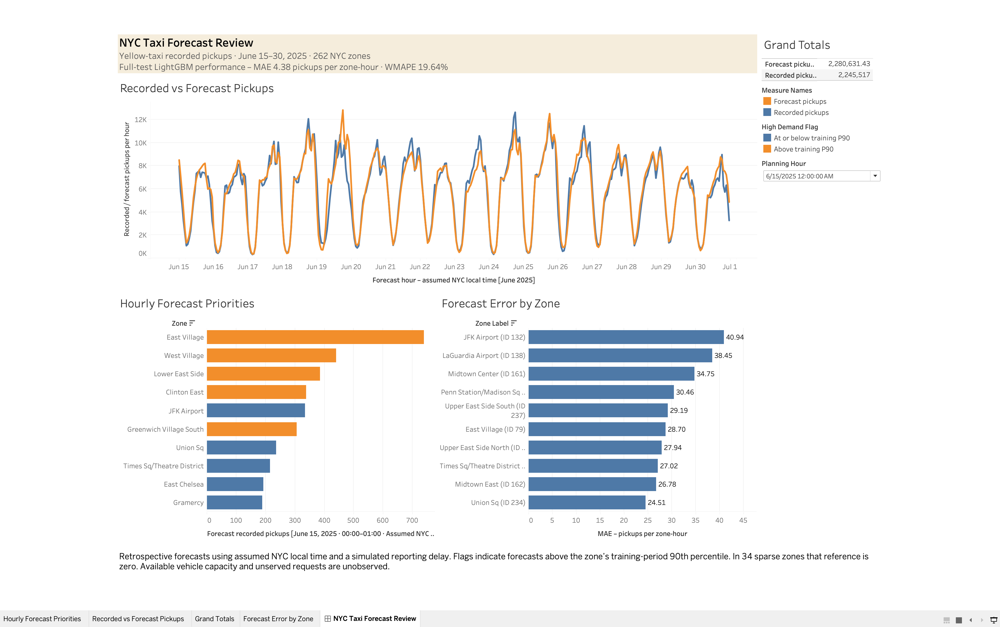

# Urban Mobility Demand Forecasting and Capacity Planning

Forecast hourly recorded NYC taxi pickups by TLC zone using the CRISP-DM framework. See the [project charter](docs/PROJECT_CHARTER.md) for the approved scope and evaluation protocol.

## Current status

Reviewed November 18, 2026.

| Work | Status and evidence |
|---|---|
| April–June benchmark | Baselines, LightGBM validation, frozen June 15–30 evaluation, MLflow model reproduction and Tableau presentation complete |
| April–September data | Six monthly zone-hour tables validated across 262 zones, including zero observed-count hours |
| Spark aggregation | All six months rebuilt with PySpark and matched every reference row exactly: 1,150,704 zone-hours and 24,554,785 accepted pickups; [verification reports](#spark-aggregation-verification) |
| Data versioning | Six raw files, one zone lookup and six prepared tables registered with DVC; user terminal output confirms Google Drive synchronization |
| Recovery test | All 13 files restored from Google Drive into a separate checkout of commit `99ce2d6` with an empty cache; file sizes and SHA-256 fingerprints matched the committed inventory |
| Expanded forecasting | July development folds, August calibration and September final holdout approved; expanded modeling and scoring pending |
| Next action | Export Spark-derived monthly datasets and complete outstanding full-row duplicate and unrelated anomaly profiling |

The [expansion protocol](configs/expansion_v1.json) defines the new evaluation dates. Spark aggregation verification is complete. The [workflow](docs/EXPANSION_WORKFLOW.md) covers the remaining preparation work and planned features/models, intervals, SHAP, FastAPI, frontend, Power BI, simulation and monitoring.

## Tableau dashboard

[](https://public.tableau.com/views/nyc_taxi_forecast_review/NYCTaxiForecastReview)

[Explore the interactive dashboard on Tableau Public](https://public.tableau.com/views/nyc_taxi_forecast_review/NYCTaxiForecastReview)

The final-test LightGBM model achieved **4.38 MAE** and **19.64% WMAPE**, a **21.24% relative WMAPE reduction** against the weekly baseline. The dashboard presents hourly forecast priorities, recorded-versus-forecast totals, and zone errors. See the [dashboard guide and findings](dashboards/tableau/README.md) for data lineage, calculations, workbook-saving instructions, and interpretation limits.

## Environment setup

Use uv from the project root. Python 3.12.13 is pinned in `.python-version`; `uv.lock` records exact dependency versions.

```sh
uv sync --locked --extra modeling --extra data-versioning
uv run --locked --extra modeling --extra data-versioning python --version
```

The `modeling` extra supplies LightGBM and MLflow; `data-versioning` supplies DVC with Google Drive support. Benchmark commands below include both extras. The environment also includes the data-inspection, plotting, notebook and test tools. Scripts cover data preparation, forecast features, baseline and LightGBM evaluation, MLflow tracking, and planning exports.

Spark verification additionally requires Java 21 with `JAVA_HOME` set to its installation and the `spark` extra, which pins PySpark 4.2.0:

```sh
uv sync --locked --extra modeling --extra data-versioning --extra spark
```

## Local data

Keep the original files at these paths:

```text
data/raw/yellow_tripdata_2025-04.parquet
data/raw/yellow_tripdata_2025-05.parquet
data/raw/yellow_tripdata_2025-06.parquet
data/raw/yellow_tripdata_2025-07.parquet
data/raw/yellow_tripdata_2025-08.parquet
data/raw/yellow_tripdata_2025-09.parquet
data/reference/taxi_zone_lookup.csv
```

The [data manifest](data/manifest.json) records source URLs, measured sizes, SHA-256 checksums, and provenance limitations. April and the lookup have user-reported November 3 download dates. May/June browser-origin URLs are verified, while their exact download dates remain unconfirmed. July–September download completion was reported November 15; exact retrieval dates and browser origins remain unconfirmed. Git stores the manifest, lockfile and adjacent `.dvc` references. Dataset contents are stored through DVC.

April–June screening, exclusion inspection, zone-hour preparation, validation selection, final testing, and planning exports are complete. The Tableau dashboard is published on Tableau Public, and its editable workbook is included under `dashboards/tableau/`.

## Restore versioned data from Google Drive

The authoritative [snapshot inventory](configs/data_snapshot_v1.json) records all 13 files, totaling 421,263,309 bytes. The [storage record](configs/google_drive_storage.json) identifies the default `gdrive` remote. DVC references are committed beside the original paths.

After cloning this repository and setting up the environment, configure a Desktop OAuth client with access to the Google Drive API. Add your account as an OAuth test user when the app is in Testing and ensure it has access to the remote folder. Follow the [DVC Google Drive authentication instructions](https://doc.dvc.org/user-guide/data-management/remote-storage/google-drive). The default DVC Google app has a documented authentication issue; the project owner used a custom Desktop client.

For macOS zsh, read the client values into temporary shell variables and save them to the private local configuration.

```zsh
read -r "DVC_CLIENT_ID?Client ID: "
read -rs "DVC_CLIENT_SECRET?Client secret: "
uv run --locked --extra modeling --extra data-versioning dvc remote modify --local gdrive gdrive_client_id "$DVC_CLIENT_ID"
uv run --locked --extra modeling --extra data-versioning dvc remote modify --local gdrive gdrive_client_secret "$DVC_CLIENT_SECRET"
unset DVC_CLIENT_ID DVC_CLIENT_SECRET
```

Retrieve the files, completing browser sign-in when prompted, then check synchronization.

```sh
uv run --locked --extra modeling --extra data-versioning dvc pull
uv run --locked --extra modeling --extra data-versioning dvc status --cloud
```

The [full restoration report](reports/data_versioning/google_drive_full_restore_v1.json) records the completed November 17 test from user-provided terminal output. A separate checkout of commit `99ce2d6` with an empty cache fetched and restored all 13 files. Every file's size and SHA-256 matched the inventory at that commit. When reproducing another data version, compare the restored files against that version's committed inventory. The earlier lookup test and connector-based claims retain their historical evidence status in the [earlier restoration record](reports/data_versioning/google_drive_restore_v1.json).

Private settings live in Git-ignored `.dvc/config.local`. Keep downloaded OAuth JSON and user tokens in private storage. Google Drive access is required to reproduce these data from the configured remote. The official source URLs provide an acquisition route whose downloaded bytes must be checked against the manifest.

## April data-quality screening

From the project root:

```sh
uv sync --locked --extra modeling --extra data-versioning
uv run --locked --extra modeling --extra data-versioning python scripts/assess_april_quality.py
```

The script verifies both inputs against the manifest, checks the lookup and required types, and scans pickup timestamps/zones in batches. Original data are unchanged. Each run creates a unique folder under `reports/data_quality/april_2025/` containing `report.md`, `report.json`, `hourly_counts.csv`, and `daily_counts.csv`.

Exit code 0 means `PASS_PRELIMINARY`; 2 means `REVIEW_REQUIRED`; 1 means the run failed or an input was invalid. Review is triggered by more than 1% combined key-quality failures, more than 1% out-of-April timestamps, zero-observed April hours, or unusually low hourly counts. The low-count flag (less than 10% of the monthly median for that clock hour) is a diagnostic heuristic, not an approved acceptance threshold or a confirmed outage.

Diagnostic counts can overlap; exclusive row dispositions and count reconciliation are recorded separately. Mapped non-NYC locations are scope exclusions. Zero-observed hours are not automatically imputed into model targets. Naive timestamps are screened under the NYC-local-time assumption, whose source semantics still require validation. Full-row duplicates and fare/distance/duration anomalies are outside this initial script.

The user's completed April run returned `PASS_PRELIMINARY`; see the [saved quality report](reports/data_quality/april_2025/20261104T053754311799Z/report.md). This does not establish source completeness or timezone semantics.

The [timestamp evidence and processing contract](docs/DATA_DOCUMENTATION.md#timestamp-decision--d05) retains the approved `America/New_York` assumption while preserving recorded clock values. Source daylight-saving semantics remain unverified; no raw timestamps were changed.

## April zone-hour preparation

The [exclusion inspection](reports/data_quality/april_2025_exclusions/20261105T074607348105Z/report.md) reconciles seven out-of-April records, 9,464 geographic exclusions, and 3,961,082 accepted pickups. The seven local date excerpts were reviewed; exclusion rules remain unchanged. See the [data documentation](docs/DATA_DOCUMENTATION.md) for exact reference labels and limitations.

Run synthetic transformation tests, then the data build:

```sh
uv run --locked --extra modeling --extra data-versioning python -m pytest -q
uv run --locked --extra modeling --extra data-versioning python scripts/build_april_zone_hour.py
```

The user's completed [April build](reports/data_preparation/april_2025/20261106T041153628221Z/report.json) validated 262 zones, 720 hours per zone, 188,640 unique zone-hours, and 3,961,082 total pickups. Each build creates a new ignored Parquet snapshot under `data/processed/april_2025/` and a versionable provenance/validation JSON under `reports/data_preparation/april_2025/`. Original files and historical reports are preserved.

## Monthly quality screening

The monthly checker supports April–September 2025. It keeps the original quality rules and derives calendar bounds and expected hours from `--month`. Field names use `month` rather than `april` (for example, `out_of_month_timestamp`). The April commands retain their historical report formats. The following commands reproduce the original benchmark screening. July–September report links and accepted totals are recorded in the [data documentation](docs/DATA_DOCUMENTATION.md#julyseptember-hourly-preparation).

First run the synthetic tests and compare the new checker with the preserved April report:

```sh
uv run --locked --extra modeling --extra data-versioning python -m pytest -q
uv run --locked --extra modeling --extra data-versioning python scripts/assess_month_quality.py --month 2025-04 --compare-april-report reports/data_quality/april_2025/20261104T053754311799Z/report.json
```

Proceed only after `Legacy April comparison: PASS` and a preliminary quality pass. Then screen the new files separately:

```sh
uv run --locked --extra modeling --extra data-versioning python scripts/assess_month_quality.py --month 2025-05
uv run --locked --extra modeling --extra data-versioning python scripts/assess_month_quality.py --month 2025-06
```

Expected calendar hours are 720, 744, and 720 for April, May, and June respectively. Record counts and quality percentages must come from actual runs. Results are written to unique `reports/data_quality/monthly/YYYY-MM/<run_id>/` folders. Exit 0 means a preliminary pass, 2 requires review, and 1 means failure; do not suppress review flags or change rules to obtain a pass.

## Monthly exclusion inspection

All six monthly screens passed preliminary checks, and April matched its historical report. The commands below reproduce the original May/June inspections. July–September inspections and the 31-row timestamp review are documented in the [data documentation](docs/DATA_DOCUMENTATION.md#julyseptember-date-exception-review).

```sh
uv run --locked --extra modeling --extra data-versioning python scripts/inspect_month_exclusions.py --month 2025-05 --baseline-report reports/data_quality/monthly/2025-05/20261108T033428313057Z/report.json
uv run --locked --extra modeling --extra data-versioning python scripts/inspect_month_exclusions.py --month 2025-06 --baseline-report reports/data_quality/monthly/2025-06/20261108T033438379619Z/report.json
```

Read the date and geographic breakdowns under `reports/data_quality/monthly_exclusions/`. Individual date excerpts stay under ignored `data/interim/monthly_exclusions/`. Review unresolved lookup labels or count mismatches before building zone-hour tables.

## May zone-hour preparation

Run the builder with the exact reports used to validate May.

```sh
uv run --locked --extra modeling --extra data-versioning python scripts/build_april_zone_hour.py --month 2025-05 \
  --quality-report reports/data_quality/monthly/2025-05/20261108T033428313057Z/report.json \
  --exclusions-report reports/data_quality/monthly_exclusions/2025-05/20261108T040104782376Z/report.json
```

The [May validation report](reports/data_preparation/monthly/2025-05/20261108T052612838884Z/report.json) records 262 zones, 744 hours per zone, 194,928 zone-hour rows and 4,581,602 accepted pickups.

## Spark aggregation verification

PySpark 4.2.0 with Java 21 reproduced the April–September 2025 monthly pickup counts across all 262 NYC zones. Every zone-hour row matched its validated reference table exactly, including zero-count hours: **1,150,704 zone-hours and 24,554,785 accepted pickups** in total.

| Month | Zone-hours | Accepted pickups | Verification report |
|---|---:|---:|---|
| April | 188,640 | 3,961,082 | [Verified](reports/data_preparation/spark/monthly/2025-04/20261118T073424016657Z/report.json) |
| May | 194,928 | 4,581,602 | [Verified](reports/data_preparation/spark/monthly/2025-05/20261118T073622896609Z/report.json) |
| June | 188,640 | 4,313,859 | [Verified](reports/data_preparation/spark/monthly/2025-06/20261118T073713404404Z/report.json) |
| July | 194,928 | 3,890,093 | [Verified](reports/data_preparation/spark/monthly/2025-07/20261118T073749400058Z/report.json) |
| August | 194,928 | 3,565,907 | [Verified](reports/data_preparation/spark/monthly/2025-08/20261118T073826018604Z/report.json) |
| September | 188,640 | 4,242,242 | [Verified](reports/data_preparation/spark/monthly/2025-09/20261118T073911151090Z/report.json) |

The command verifies source and lookup fingerprints, the selected reference dataset, month boundaries and expected dimensions before aggregation. It compares the rebuilt and reference rows in both directions. Each successful comparison records source, reference, code and lockfile fingerprints, runtime versions and the Spark application ID.

From the project root, run one month with its original validated preparation report:

```sh
uv run --locked --extra modeling --extra data-versioning --extra spark \
  python scripts/build_spark_zone_hour.py \
  --month 2025-04 \
  --reference-report reports/data_preparation/april_2025/20261106T041153628221Z/report.json
```

Successful runs save a report under `reports/data_preparation/spark/monthly/<month>/<run_id>/` and local event logs under Git-ignored `artifacts/spark/events/`. The current command rebuilds and compares tables during execution. Exporting new Spark datasets and profiling full-row trip duplicates and unrelated anomalies remain pending. September checks verify the predefined preparation rules; September model evaluation remains reserved for the expanded experiment.

All **49 tests passed** in the user-run suite, including synthetic Spark tests covering month boundaries, repeated records, excluded zones, inactive zones and timestamp interpretation. To run the suite with Spark enabled:

```sh
uv run --locked --extra modeling --extra data-versioning --extra spark \
  python -m pytest -p no:cacheprovider -q
```

PySpark emits a pandas 3 compatibility warning. The verified path uses Spark SQL and Parquet; Spark pandas integration has not been validated. Source timezone semantics remain the explicit D05 assumption, and accepted counts do not establish unique physical trips or complete source coverage.

To inspect completed applications, start the History Server in a separate terminal from the project root:

```sh
mkdir -p artifacts/spark/events
SPARK_PACKAGE_ROOT="$("$PWD/.venv/bin/python" -c \
  'from pathlib import Path; import pyspark; print(Path(pyspark.__file__).resolve().parent)')"
export SPARK_HISTORY_OPTS="-Dspark.history.fs.logDirectory=artifacts/spark/events"
export SPARK_DAEMON_MEMORY=512m
"$SPARK_PACKAGE_ROOT/bin/spark-class" org.apache.spark.deploy.history.HistoryServer
```

Keep that terminal running and open the [local History Server](http://localhost:18080). The foreground launcher and project-relative log directory handle spaces in the repository path. Application history remains available locally while its event logs are retained.

## Connect the benchmark stages

Each preparation command prints its output report path. Pass that path
explicitly to the next stage.

| Script | Input arguments |
|---|---|
| `combine_zone_hours.py` | Uses the three validated monthly snapshots |
| `prepare_forecast_features.py` | `--source-report` selects the combined-data report |
| `score_validation_baselines.py` | `--source-report` selects the feature report |
| `validate_lightgbm.py` | `--source-report` selects the feature report; `--baseline-report` selects its baseline results |

The commands default to the original benchmark reports when these arguments
are omitted. For a regenerated pipeline, supply the newly printed report
paths.

The regenerated April–June preparation and baseline stages reproduced
572,208 zone-hours and weekly-baseline validation WMAPE of 23.935957%.
The LightGBM loader accepted the new reports with 339,028 training rows
and 87,770 validation rows. The 38-test suite at that stage passed.

Model fitting through the report arguments reproduced validation MAE
4.353107973 and WMAPE 18.547864672%. MLflow run
`9046eecd82994dd392dc1e67b2c1af2b` recorded the selected model, training
history, input reports and current locked environment. Reloading the saved
model in a fresh Python process produced identical validation predictions.
Input-report fingerprints and the lockfile fingerprint passed verification.
See the [current-environment reproduction report](reports/reproducibility/9046eecd82994dd392dc1e67b2c1af2b/report.json).

## Combine April through June

Run `uv run --locked --extra modeling --extra data-versioning python scripts/combine_zone_hours.py` from the project root with the three pinned monthly snapshots available locally. The [combined validation report](reports/data_preparation/april_june_2025/20261108T062052975430Z/report.json) records the input and output fingerprints and confirms 2,184 consecutive hours for each of 262 zones.

## Prepare forecast features and splits

Run `uv run --locked --extra modeling --extra data-versioning python scripts/prepare_forecast_features.py` from the project root. The [feature report](reports/data_preparation/forecast_features/20261108T064005732515Z/report.json) identifies the input and output snapshots and lists the predictor columns. Treat pickup zone as categorical when loading the table. Use `pickup_count` as the target and `split` to select initial fitting, validation, and final-test rows. For the June 15 refit, `refit_eligible` includes the May 31 embargo hour because its count is available by June 15. Warm-up rows supply history.

Each lag uses the same zone's observations. Each trailing mean ends two hours before the forecast origin. The one-hour delay after a bucket closes is the charter's simulated reporting delay.

## Validation baselines

Run `uv run --locked --extra modeling --extra data-versioning python scripts/score_validation_baselines.py` after preparing forecast features. The script reads the pinned feature snapshot, freezes the top 20 zones by initial training volume, and evaluates all three lag baselines on the same validation cells. Each run saves weekly and pooled scores, error breakdowns and provenance under `reports/baselines/` and adds an entry to `reports/experiments.csv`. The [validation metrics](reports/baselines/20261108T233614690012Z/validation_metrics.csv) select the weekly seasonal baseline as the reference for the candidate model.

## LightGBM validation

From the project root, run `uv run --locked --extra modeling --extra data-versioning python scripts/validate_lightgbm.py`. The modeling extra installs the locked LightGBM dependencies. The run uses the same training and validation dates as the baselines. It fits six Poisson models sequentially and stops each fit after 50 rounds without a validation MAE improvement, up to 500 rounds.

The run writes all six scores, the best candidate's weekly and zone errors, the 20-zone comparison, and the calendar-and-zone-only diagnostic under `reports/lightgbm_validation/`. The report identifies the validation-selected method and the iteration count for the subsequent refit.

## Local MLflow tracking

From the project root, start the loopback tracking server in one terminal. SQLite and saved artifacts live together under the Git-ignored `artifacts/mlflow/` directory.

```sh
mkdir -p artifacts/mlflow
uv run --locked --extra modeling --extra data-versioning mlflow server --host 127.0.0.1 --port 5050 --workers 1 --backend-store-uri sqlite:///artifacts/mlflow/tracking.db --artifacts-destination ./artifacts/mlflow/files
```

Open the tracking UI at http://127.0.0.1:5050. In a second terminal, run the tracking check and keep its printed run ID.

```sh
export MLFLOW_TRACKING_URI=http://127.0.0.1:5050
uv run --locked --extra modeling --extra data-versioning python scripts/check_mlflow.py
```

Stop the server with Ctrl-C, restart it with the same command from the project root, and verify the original run.

```sh
uv run --locked --extra modeling --extra data-versioning python scripts/check_mlflow.py --verify <RUN_ID>
```

Replace `<RUN_ID>` with the ID from the first check. A pass confirms that the experiment, completed run, parameter, and artifact text survived the restart.

## Reproduce the selected model with MLflow

With the local tracking server running, reproduce the selected validation fit from the project root.

```sh
uv run --locked --extra modeling --extra data-versioning python scripts/reproduce_validation.py
```

The command records the original experiment, data and code fingerprints, Git revision, locked environment, 500-round training history, input column order and zone categories. It compares validation MAE and WMAPE with the reference at absolute tolerance 0.000001, then downloads the logged native LightGBM model in a fresh Python process and compares every validation prediction. Each successful verification writes a small report under `reports/reproducibility/<run_id>/`.

The original training-script fingerprint is recoverable by restoring line wrapping around the training call. The before-tracking source is preserved under `reports/reproducibility/validation_script_before_tracking.py`; its parsed Python syntax matches that reconstructed original. The shared input loader now supports the original six-model comparison and the reproduction run.

The fitted model is an MLflow artifact at `runs:/<run_id>/model/model.txt`. Load it by downloading it with `mlflow.artifacts.download_artifacts` and passing that path to `lightgbm.Booster(model_file=...)`. Restore the feature order and categorical zone IDs recorded in `feature_schema.json` before prediction. Model files and validation prediction rows remain under ignored artifact storage. Back up the SQLite database and artifact folder together to preserve local experiment access.

## Frozen final evaluation

The [final test report](reports/final_evaluation/71dcb809d5c0409484d8b55b21751f17/report.json) records the June 15–30 evaluation of 100,608 zone-hours after refitting on 427,060 eligible rows for 500 rounds. LightGBM achieved MAE 4.383744 and WMAPE 19.640898%, compared with weekly baseline WMAPE 24.936262%. Its 21.235598% relative improvement and all 20 busy-zone checks satisfy the charter's recommendation rule.

`scripts/evaluate_final_test.py` saves the fixed protocol before reading test rows and records the native model, input schema, predictions and diagnostics in MLflow. A fresh Python process verifies the model's predictions. The command detects an existing completed evaluation and prints its report path on subsequent invocations.

```sh
uv run --locked --extra modeling --extra data-versioning python scripts/evaluate_final_test.py
```

The local tracking server must be running. See the run at http://127.0.0.1:5050/#/experiments/1/runs/71dcb809d5c0409484d8b55b21751f17.

The [historical reproduction report](reports/final_evaluation/f677e1268be24ed1bc62148442dbe380/report.json) records verified MLflow run `f677e1268be24ed1bc62148442dbe380`. It refitted the frozen configuration on 427,060 rows and evaluated the same 100,608 June zone-hours. MAE and WMAPE matched the original evaluation exactly for LightGBM and all three baselines, with maximum metric difference 0.0 at an absolute tolerance of 0.000001. LightGBM retained MAE 4.383744, WMAPE 19.640898%, all 20 busy-zone checks and the original recommendation. Reloaded predictions matched exactly, and the model and prediction-file SHA-256 fingerprints matched the original artifacts.

To repeat that historical reproduction with the linked validation evidence, keep the local tracking server running and supply the reports explicitly:

```sh
uv run --locked --extra modeling --extra data-versioning \
  python scripts/evaluate_final_test.py \
  --source-report reports/data_preparation/forecast_features/20261118T041218185118Z/report.json \
  --reference-report reports/lightgbm_validation/20261118T045410807447Z/report.json \
  --verification-report reports/reproducibility/9046eecd82994dd392dc1e67b2c1af2b/report.json \
  --reproduce-report reports/final_evaluation/71dcb809d5c0409484d8b55b21751f17/report.json
```

The explicit reproduction mode checks the frozen protocol, creates a separate MLflow run labelled `historical-reproduction` and compares its results with the original evaluation. This verifies repeatability of the previously evaluated June benchmark. September remains reserved for the expanded experiment's final evaluation.

The DVC snapshot covers source data and monthly prepared tables. The benchmark commands also depend on pinned combined/feature snapshots and saved MLflow model/prediction artifacts referenced by their reports and scripts. Reproducing those artifacts from a fresh checkout requires checking their generated paths against the pinned inputs before proceeding. Complete clean-environment reproduction remains a delivery check.

## Planning interpretation

Run `uv run --locked --extra modeling --extra data-versioning python scripts/create_planning_outputs.py` with local MLflow running. The script retrieves the saved final-test predictions, verifies fingerprints and writes hourly competition ranks, strict high-demand flags and zone labels to ignored CSV/Parquet files under `reports/forecasts/<run_id>/`. The CSV is suitable for a Tableau zone/hour review with filters for forecast rank, predicted pickups and historical reference.

The [planning findings](reports/planning/f3b0488bb9e34707942376c86010a661/findings.md) include zone, date, hour and weekday errors, two charts and the training-only percentile reference. The reference values were materialized after final evaluation using the initial training interval and the charter's predeclared percentile rule. A zero reference in sparse zones causes any positive prediction to trigger the flag. Display predicted volume and the reference together when interpreting those zones. Vehicle supply and unmet requests remain unobserved.
