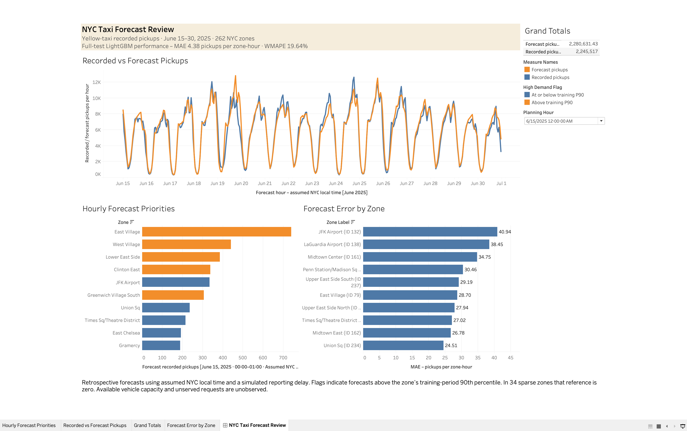

# NYC Taxi Forecast Review

[](https://public.tableau.com/views/nyc_taxi_forecast_review/NYCTaxiForecastReview)

[Explore the interactive dashboard on Tableau Public](https://public.tableau.com/views/nyc_taxi_forecast_review/NYCTaxiForecastReview)

The dashboard reviews retrospective yellow-taxi recorded pickup forecasts for June 15–30, 2025 across 262 NYC taxi zones. The selected-hour view ranks zones by forecast pickups; the time-series and error views cover the full test period.

## Dashboard artifacts

| Artifact | Location or status |
|---|---|
| Dashboard preview | [PNG](../../public/assets/images/nyc-taxi-forecast-dashboard.png), supplied by the project owner |
| Editable workbook | [nyc_taxi_forecast_review.twb](nyc_taxi_forecast_review.twb) |
| Interactive public URL | [Tableau Public dashboard](https://public.tableau.com/views/nyc_taxi_forecast_review/NYCTaxiForecastReview) |
| Planning source | `reports/forecasts/f3b0488bb9e34707942376c86010a661/planning.csv` |
| Data provenance | [Planning report](../../reports/planning/f3b0488bb9e34707942376c86010a661/report.json) |
| Evaluation protocol | [Frozen protocol](../../reports/final_evaluation/71dcb809d5c0409484d8b55b21751f17/protocol.json) |

The preview documents the visible dashboard. Parameter behavior and tooltip contents require verification in the saved workbook.

## Findings

All methods use the same 100,608 test zone-hours, covering 384 hours in each zone.

| Method | MAE, pickups per zone-hour | WMAPE |
|---|---:|---:|
| LightGBM | 4.38 | 19.64% |
| Weekly seasonal | 5.57 | 24.94% |
| Daily seasonal | 7.45 | 33.40% |
| Persistence | 9.00 | 40.32% |

LightGBM reduced WMAPE by 21.24% relative to the weekly baseline and passed the charter's MAE guardrail in all 20 busiest training zones. The frozen model uses 31 leaves, 50 minimum samples per leaf and 500 boosting rounds. See the [final metrics](../../reports/final_evaluation/71dcb809d5c0409484d8b55b21751f17/metrics.csv).

- Recorded pickups totaled 2,245,517. Forecast pickups totaled 2,280,631.43. Opposing errors across zones can cancel in the overall totals.
- JFK Airport had the largest zone MAE at 40.94, followed by LaGuardia Airport at 38.45 and Midtown Center at 34.75.
- Across all zones, 23:00 had the largest average error by clock hour. June 19 had the largest daily average error.
- 17,622 forecast cells exceeded their zone's initial-training 90th percentile. In 34 zones, that reference was zero.

Detailed error slices and interpretations are in the [planning findings](../../reports/planning/f3b0488bb9e34707942376c86010a661/findings.md).

## Reopen and verify

1. Save the editable workbook using Tableau's Save As command at the path above. A `.twb` keeps the workbook definition and references its data files. A `.twbx` bundles local data and images. [Tableau saving documentation](https://help.tableau.com/current/pro/desktop/en-us/save_savework.htm)
2. Keep the source CSV at the planning-source path above. If reopening on another machine, reconnect Tableau's text-file connection to the reproduced CSV.
3. To regenerate the export with the final prediction artifact available in local MLflow, run `uv run --locked --extra modeling python scripts/create_planning_outputs.py` from the project root. Each run writes a new forecast directory; reconnect Tableau to that run's CSV.
4. Verify 262 zones, 384 hours and 100,608 rows before worksheet filters.
5. Verify the two full-period totals above and JFK's 40.94 MAE.
6. Set Planning Hour to June 15, 2025 at 00:00. East Village should lead at approximately 740.21 forecast pickups. Change the hour and confirm the priority chart updates while full-period charts retain their coverage.
7. Verify tooltip values and rename or resize truncated labels before exporting the final presentation image.

## Tableau calculations

`Forecast Hour` preserves the recorded local-clock string.

```text
DATEPARSE("yyyy-MM-dd HH:mm:ss", LEFT([Hour Start], 19))
```

`Selected Forecast Hour` filters the priority sheet using a Date & Time parameter.

```text
[Forecast Hour] = [Planning Hour]
```

`Absolute Error` is computed for each zone-hour before averaging.

```text
ABS([Pickup Count] - [Lightgbm])
```

`WMAPE` uses the sum of cell errors and the sum of recorded pickups. Format the result as a percentage.

```text
IF SUM([Pickup Count]) > 0 THEN
    SUM([Absolute Error]) / SUM([Pickup Count])
END
```

The zone-error view uses AVG(Absolute Error), grouped by zone ID and label. The priorities sheet uses the exported forecast rank and flag. The latter is a strict forecast > training percentile comparison, with linear percentile interpolation. Reference values were materialized after final evaluation using initial training rows and the predeclared rule.

## Storage and interpretation

Version the editable `.twb`, preview and this guide. The repository ignores packaged workbooks, extracts and bulk forecast data under the paths defined in `.gitignore`. Packaged workbooks can be retained locally as portable copies.

The target is recorded served pickups. Vehicle capacity, unserved requests and operational improvements require separate evidence. NYC local time and the one-hour reporting delay after bucket closure remain assumptions.

Public publishing makes workbook data accessible to others. Review the aggregate data and descriptions before publishing. [Tableau Public publishing documentation](https://help.tableau.com/current/pro/desktop/en-us/publish_workbooks_tableaupublic.htm)
